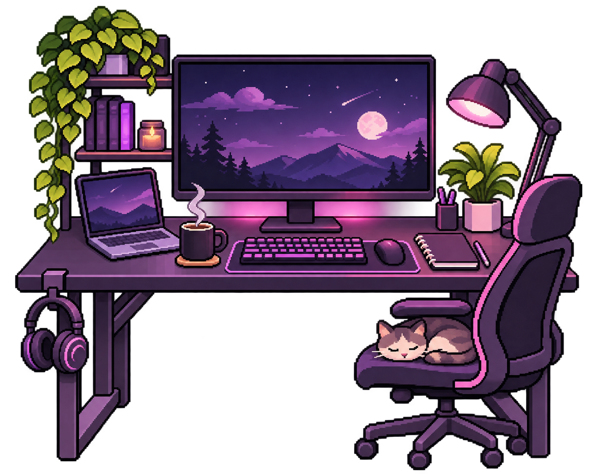
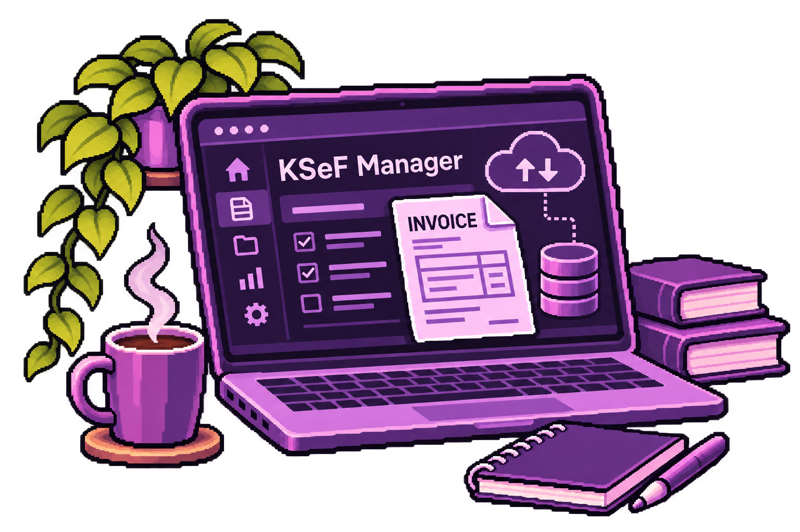

  

  

  
  
  
  

 

 

<h2 align="center" style="font-size:28px; font-weight:bold;">About Me</h2>

  I’m a <strong>Computer Science student</strong> at the
  <strong>University of Łódź</strong>, specializing in
  <strong>Programming and Algorithms</strong>, currently completing
  my engineering degree.

  I have <strong>hands-on commercial development experience</strong>
  from my <strong>.NET Developer internship at De Heus</strong>,
  where I worked across the full stack, contributing to the
  <strong>development, maintenance, and improvement of business applications</strong>,
  including <strong>ERP-related solutions</strong>,
  database integrations, and internal business tools.

  My main focus is <strong>.NET and backend development</strong>,
  particularly <strong>API design, relational databases,
  application architecture, and security</strong>.
  I also enjoy combining technical problem-solving with
  <strong>UI/UX design</strong> to build reliable, maintainable,
  and user-friendly software.

 

 

<h2 align="center" style="font-size:28px; font-weight:bold;">My Skills</h2>

<h3 align="center">Programming Languages</h3>

  
  
  
  
  
  
  

<h3 align="center">Backend &amp; Frameworks</h3>

  
  
  
  
  
  
  
  
  
  

<h3 align="center">Authentication &amp; API Security</h3>

  
  
  
  
  

<h3 align="center">Frontend</h3>

  
  
  
  
  
  
  

<h3 align="center">Databases</h3>

  
  
  
  

<h3 align="center">Data Science &amp; AI/ML</h3>

  
  
  
  
  
  
  
  
  
  
  
  

<h3 align="center">Testing &amp; API Tools</h3>

  
  
  
  

<h3 align="center">DevOps, Workflows &amp; CI/CD</h3>

  
  
  
  
  
  
  
  

<h3 align="center">Enterprise Systems &amp; ERP</h3>

  
  
  

<h3 align="center">Scripting &amp; Automation</h3>

  
  
  
  

<h3 align="center">AI Development Tools</h3>

  
  
  
  
  
  
  

<h3 align="center">IDEs &amp; Development Tools</h3>

  
  
  
  
  
  

<h3 align="center">Design, 3D &amp; Game Development</h3>

  
  
  
  
  
  
  

  

<h2 align="center" style="font-size:28px; font-weight:bold;">
  Current Focus
</h2>

  <strong>Engineering Thesis</strong> ·
  <strong>Full-Stack Development</strong> ·
  <strong>Electronic Invoicing</strong> ·
  <strong>API Integration</strong>

 

  I'm currently developing <strong>KSeF Manager</strong>,
  a <strong>full-stack web application</strong> designed to
  simplify electronic invoice management and support
  integration with Poland's
  <strong>National e-Invoicing System (KSeF)</strong>.
  The project is part of my <strong>engineering thesis</strong>
  at the University of Łódź.

  The application is designed to support
  <strong>invoice creation and management</strong>,
  communication with the <strong>KSeF API</strong>,
  and secure access to business data.
  My goal is to build a <strong>reliable, maintainable,
  and user-friendly system</strong> that simplifies
  everyday invoicing workflows.

  My current work focuses on
  <strong>ASP.NET Core backend development</strong>,
  <strong>database integration</strong>,
  <strong>authentication and authorization</strong>,
  and <strong>API security and testing</strong>,
  alongside ongoing frontend development.

 

 

 

<h2 align="center">Professional Experience</h2>

<h3 align="center">De Heus | .NET Developer Intern</h3>

  <strong>Enterprise Software</strong> ·
  <strong>Full-Stack Development</strong> ·
  <strong>ERP Integration</strong>

  Contributed to the development, maintenance, and
  enhancement of commercial business applications,
  working across frontend, backend, relational databases,
  and enterprise systems.

 

<table align="center">
  <tr>
    <td align="center" width="33%">
      <strong>Full-Stack Development</strong>
       
      Business applications & internal tools
    </td>
    <td align="center" width="33%">
      <strong>ERP & Databases</strong>
       
      Comarch ERP XL & data integration
    </td>
    <td align="center" width="33%">
      <strong>Software Maintenance</strong>
       
      Existing systems & feature improvements
    </td>
  </tr>
</table>

 

<h3>Selected Projects & Contributions</h3>

<table>
  <tr>
    <td width="30%">
      <strong>XL Session Manager</strong>
       
      C# · WPF · ERP XL
    </td>
    <td>
      Developed a desktop application for managing
      sessions in the Comarch ERP XL environment.
    </td>
  </tr>
  <tr>
    <td>
      <strong>Config Attributes Panel</strong>
       
      Angular · TypeScript
    </td>
    <td>
      Developed and enhanced an interface for
      configuring and managing business attributes.
    </td>
  </tr>
  <tr>
    <td>
      <strong>Commission</strong>
       
      Angular · .NET
    </td>
    <td>
      Maintained and improved an existing
      full-stack business application.
    </td>
  </tr>
  <tr>
    <td>
      <strong>SASS</strong>
       
      Blazor · MudBlazor
    </td>
    <td>
      Contributed to the development and
      improvement of an internal business application.
    </td>
  </tr>
  <tr>
    <td>
      <strong>KNT Attributes</strong>
       
      C# · Comarch ERP XL
    </td>
    <td>
      Developed functionality supporting contractor
      attributes and ERP integration.
    </td>
  </tr>
</table>

 

 

<h2 align="center" style="font-size:28px; font-weight:bold;">Stats</h2>

  
  

  

 

 

  <picture>
    <source
      media="(prefers-color-scheme: dark)"
      srcset="https://raw.githubusercontent.com/Avuii/Avuii/output/pacman-contribution-graph-dark.svg"
    />
    <source
      media="(prefers-color-scheme: light)"
      srcset="https://raw.githubusercontent.com/Avuii/Avuii/output/pacman-contribution-graph.svg"
    />
    
  </picture>

 

---
   

  

 

  <em>Thanks for visiting my profile — feel free to reach out or ⭐ one of my projects!</em>

