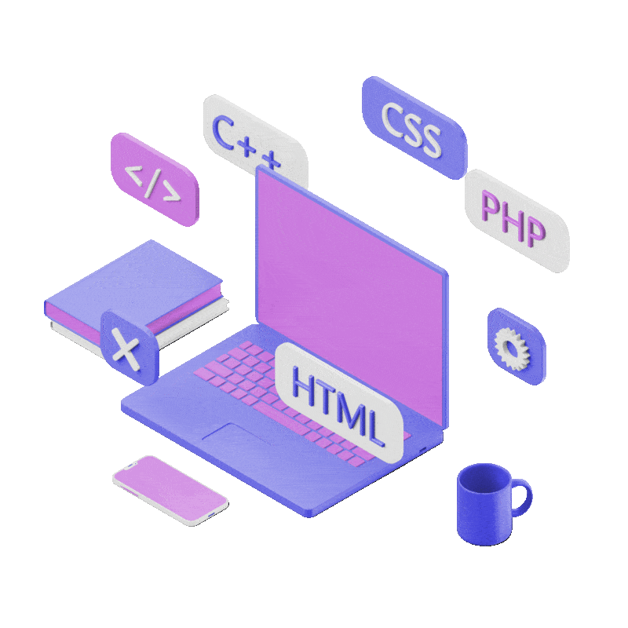
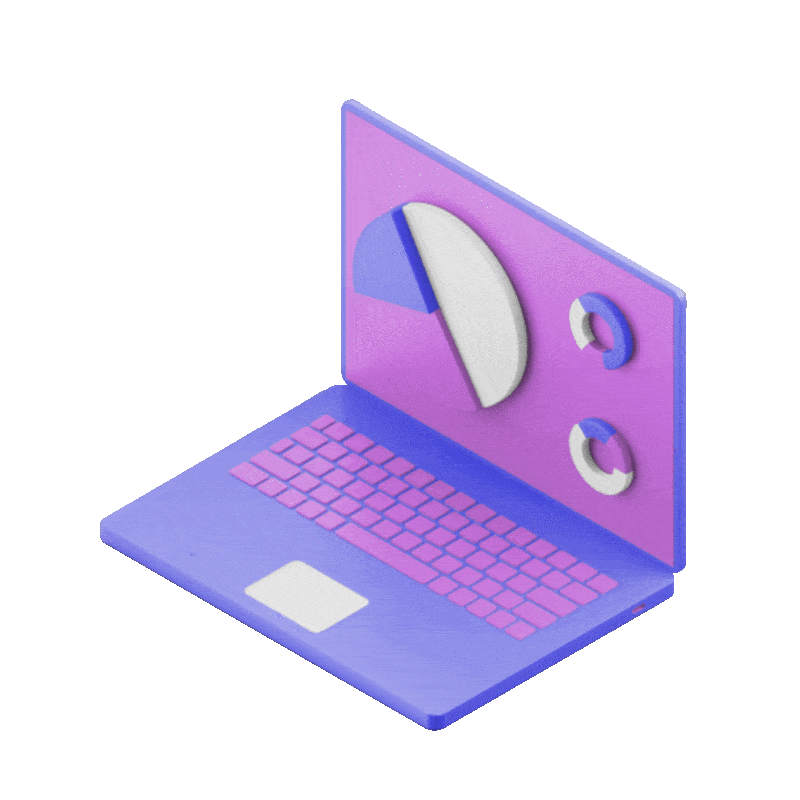

  

 

  

  
  
  
  

 

 

<h2 align="center" style="font-size:28px; font-weight:bold;">About Me</h2>

  I’m an <strong>Applied Computer Science student</strong> at the <strong>University of Łódź</strong>, specializing in <strong>Programming and Algorithms</strong>.

  I’m growing as a <strong>.NET Developer</strong>, with a focus on <strong>business applications</strong>, <strong>databases</strong>, <strong>clean UI</strong>, and practical software solutions.

  I enjoy combining <strong>technical problem-solving</strong> with <strong>visual design</strong> — building applications that are not only working, but also clear, useful, and pleasant to use.

  Currently, I work mostly with <strong>C#</strong>, <strong>.NET</strong>, <strong>SQL</strong>, <strong>Entity Framework Core</strong>, and frontend technologies such as <strong>Angular</strong> and <strong>React</strong>.

 

 
 
<h2 align="center" style="font-size:28px; font-weight:bold;">My Skills</h2><h3 align="center">Programming Languages</h3>

  
  
  
  
  
  
  

<h3 align="center">Backend &amp; Frameworks</h3>

  
  
  
  
  
  
  
  
  

<h3 align="center">Authentication &amp; API Security</h3>

  
  
  
  
  

<h3 align="center">Frontend</h3>

  
  
  
  
  
  
  

<h3 align="center">Databases &amp; Data Science</h3>

  
  
  
  
  
  
  
  
  
  

<h3 align="center">Testing &amp; API Tools</h3>

  
  
  
  

<h3 align="center">DevOps, Workflows &amp; CI/CD</h3>

  
  
  
  
  
  
  
  

<h3 align="center">Scripting &amp; Automation</h3>

  
  
  
  

<h3 align="center">AI Tools & AI-Assisted Development</h3>

  
  

  
  
  
  
  

  
  
  
  
  
  

<h3 align="center">Design, 3D &amp; Game Development</h3>

  
  
  
  
  
  
  

    

<h2 align="center" style="font-size:28px; font-weight:bold;">Current Focus</h2>

  <strong>.NET Development</strong> · <strong>Business Applications</strong> · <strong>Databases</strong> · 
  <strong>UI Design</strong> · <strong>Cybersecurity Basics</strong> · <strong>Qt / C++</strong>

 

  I’m currently focused on building stronger foundations in <strong>.NET backend development</strong>, 
  <strong>SQL databases</strong>, and <strong>real-world business application design</strong>.

  At the same time, I’m exploring <strong>cybersecurity</strong>, especially topics connected with 
  secure applications, API security, authentication, input validation, and understanding how systems can fail.

  I’m also developing my skills in <strong>C++ and Qt</strong>, creating desktop applications with clean interfaces, 
  local databases, and practical user workflows.

 

 
  
 

<h2 align="center" style="font-size:28px; font-weight:bold;">Stats</h2>

  
  

  

 

 

  <picture>
    <source
      media="(prefers-color-scheme: dark)"
      srcset="https://raw.githubusercontent.com/Avuii/Avuii/output/pacman-contribution-graph-dark.svg"
    />
    <source
      media="(prefers-color-scheme: light)"
      srcset="https://raw.githubusercontent.com/Avuii/Avuii/output/pacman-contribution-graph.svg"
    />
    
  </picture>

 

---
   

  

 

  <em>Thanks for visiting my profile — feel free to reach out or ⭐ one of my projects!</em>

